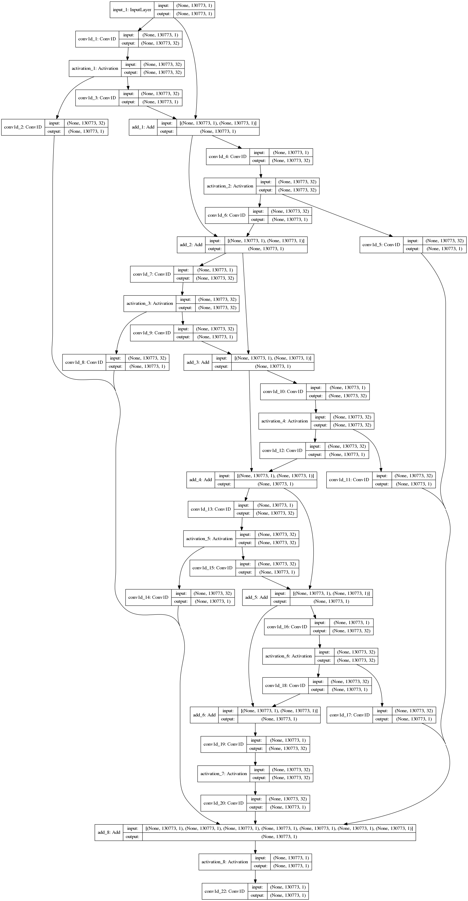

# StockNet

**Multivariate stock-price forecasting with temporal convolutions and news-derived features.**

StockNet explores how causal, dilated convolutional networks can combine historical prices with information extracted from financial news. Developed as part of my MSc research at the Federal University of Amazonas (UFAM), the architecture draws on sequence models used in speech synthesis.

[Read the thesis](https://tede.ufam.edu.br/handle/tede/7409) · [Model implementation](models.py) · [Experiment script](run_experiments.py)

## Research approach

- Combine closing prices with news-derived sentiment features.
- Model temporal dependencies using causal, dilated 1D convolutions, residual connections, and skip connections.
- Compare the multivariate model with a price-only WaveNet-style model and a structured-event baseline implemented with a random forest.

The public implementation uses the input columns `close`, `pos`, `neg`, `lit`, `unc`, and `con`. See the thesis for the full research methodology and reported results.

## Model reference



The figure above provides a WaveNet-style architecture reference. The StockNet implementation is defined in [models.py](models.py).

## Repository guide

| File | Purpose |
| --- | --- |
| `models.py` | StockNet and price-only WaveNet-style models |
| `data_import.py` | Data import |
| `clean_dates.py` | Date preprocessing |
| `break_news_30min.py` | News alignment to 30-minute intervals |
| `sentiment_extraction.py` | News sentiment extraction |
| `split_assets.py` | Per-asset data preparation |
| `oie_extraction.py` | Open information extraction for the structured-event workflow |
| `merge_price_news.py` | Price and news merging |
| `run_experiments.py` | Training, prediction, and baseline comparisons |

## Data

The news corpus follows the dataset used by Ding et al. (2014):

Xiao Ding, Yue Zhang, Ting Liu, and Junwen Duan. *Using structured events to predict stock price movement: An empirical investigation.* EMNLP 2014, pp. 1415–1425.

The original price dataset covers ten US stocks at 30-minute intervals from January 2004 to August 2018. The full price dataset is not included in this repository. A news sentiment CSV is included under `dataset/`.

## Working with the research code

This is a **partial historical research implementation**, rather than a ready-to-run forecasting package. The original environment used Python 3.7 and legacy TensorFlow APIs.

1. Inspect [requirements.txt](requirements.txt) and prepare a compatible research environment.
2. Install dependencies:

   ```bash
   python -m pip install -r requirements.txt
   ```

3. Configure dataset locations and output directories in the scripts.
4. Review the preprocessing stages in the repository guide before running experiments.

The experiment script expects prepared per-stock data, including the news features and the `see` column used by the structured-event baseline.

## Reproducibility and limitations

- Dataset paths and experiment settings are hard-coded.
- The full datasets and trained checkpoints are not bundled.
- The implementation uses legacy TensorFlow and pandas APIs that need adaptation for current environments.
- `run_experiments.py` references `rmse_wn_str` while its assignment is commented out; this needs correction before running the script end to end.
- Results have not been independently rerun as part of this documentation update. Consult the thesis for reported experimental findings.

## Citation

```bibtex
@mastersthesis{nascimento2019stocknet,
  title   = {StockNet: A Multivariate Deep Neural Architecture for stock prices prediction},
  author  = {Nascimento, Janderson Borges},
  school  = {Universidade Federal do Amazonas},
  address = {Manaus, Brazil},
  year    = {2019},
  month   = {9},
  url     = {https://tede.ufam.edu.br/handle/tede/7409}
}
```

## License

[MIT](LICENSE).
